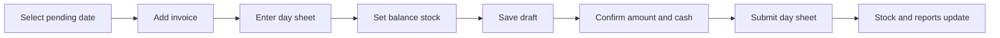

# Cashier Flow

## Screenshots

### Cashier Dashboard


### Stock Page


## End-to-End Flow



## 1. Sign In

1. The cashier signs in through `/login`.
2. The authenticated cashier is sent to `/cashier-home`.
3. Cashier dashboard access requires role `User`.
4. The session identifies the assigned shop through `shopId`.

## 2. Cashier Dashboard

Route: `/cashier-home`

| Action | Route | Purpose |
| --- | --- | --- |
| Day Sheet | `/sheet-date` | Select and initialize the next pending day sheet |
| Manage Partners Transactions | `/manage-partners` | View or manage partner transactions |
| Stock | `/stock` | View submitted stock and download a PDF |
| Profile | `/profile` | View account details and change password |
| Logout | N/A | End the authenticated session |

Opening Day Sheet stores the assigned shop in session storage.

## 3. Select the Day-Sheet Date

Route: `/sheet-date`

1. The assigned shop is loaded.
2. Submitted dates are read from Firebase and local fallback storage.
3. The first pending date from the shop opening date through today is selected.
4. Future dates are prevented.
5. Sheets must be submitted in date order.
6. Already submitted dates are blocked.

Actions:

- `Add Invoice` opens `/invoice`.
- `Proceed` opens `/day-sheet`.
- Back returns to `/cashier-home`.

## 4. Add Invoice

Route: `/invoice`

The cashier searches for a brand by name or code, enters bottle quantities by size, reviews MRP and amount, and saves the invoice. Invoice data is used to build the day sheet's opening stock and sales records.

After saving, the cashier returns to the day-sheet workflow.

## Opening Stock

Route: `/opening-stock`

- Opening Stock is available while the opening-date day sheet is pending and no submitted opening-stock record exists. An existing draft can be reopened and updated.
- Each shop has one Firestore record at `openingStock/{opening-stock-shop-id}`. Saving updates that record with `status: "draft"`; submitting updates the same record to `status: "submitted"`.
- Units per case and MRP are read from the MRP catalog for the selected size. Units per case is read-only; if the catalog has no value, it displays and counts as `0`. Units per case is optional for submission.
- A duplicate combination of Brand Code, Brand Name, and Size is not allowed.
- Before submission, the cashier reviews a one-time confirmation. Rows with stock require a valid size and MRP, and at least one case or delivered-bottle quantity must be entered.
- Submitted opening stock cannot be edited or submitted again. Draft opening stock does not seed the Day Sheet.
- Day Sheet loads the shop's opening-stock record from Firestore before building first-day rows. Browser storage is only a cache and is not the cross-browser source of truth.

## 5. Enter the Day Sheet

Route: `/day-sheet`

The day sheet combines invoice data, saved entries, previous closing stock, and the MRP catalog.

Each brand and size displays opening stock, balance stock, sales stock, MRP or price, and sales amount. The cashier can also add expenses, additional profit, and cash details.

### Balance-stock rule

- Minimum value is `0`.
- Maximum value is that size's opening stock.
- A value above the maximum is immediately clamped to the opening stock.
- Blank balance stock is optional.
- Sales are calculated as `opening - balance`.

Cash details include cash deposit, PhonePe/Paytm, comments, and an optional bank challan receipt upload.

## 6. Save as Draft

The `Save` button stores the current day sheet without finalizing it.

Firebase storage uses one deterministic document per shop and date:

```text
daySheets/{shop-date}
```

Save writes:

```text
status: "draft"
draft: true
```

Saving again for the same shop and date updates the same document. The draft is also cached in browser storage for recovery. Drafts are excluded from submitted reports, stock, and submitted-date locks.

## 7. Submit the Day Sheet

The cashier selects `Submit` and confirms the sheet amount.

Submission checks:

1. Sold sizes must have an MRP or price.
2. Entered sheet amount must match the calculated grand total.
3. Cash deposit plus PhonePe/Paytm must match the grand total.
4. Bank challan receipt upload is optional.

On success, the same document is updated:

```text
status: "submitted"
draft: false
submittedAt: <timestamp>
```

The submitted date becomes unavailable in `/sheet-date`, and the next pending date becomes available.

## 8. Stock View

Route: `/stock`

The Stock page reads the latest submitted day sheet for the cashier's shop. Rows with stock equal to zero are removed.

Displayed columns are serial number, code, brand name, MR size, MRP, stock, and cost. The cashier can download the visible stock report as a PDF using the same column order and filtering.

## 9. Partner Transactions

Route: `/manage-partners`

This route is available to cashiers and owners. The cashier can view or manage partner transaction records using the available page actions.

## 10. Profile and Logout

Route: `/profile`

The cashier can view name, email, and role; change the password after confirming the current password; return to `/cashier-home`; or logout.

## 11. Storage Summary

The day-sheet lifecycle is:

```text
Save    -> daySheets/{shop-date}, status: "draft"
Submit  -> daySheets/{shop-date}, status: "submitted"
```

This prevents separate new draft and submitted documents for the same shop and date. Existing records in the old `daySheetDrafts` collection are historical data and are not automatically removed.

When Firebase is unavailable or not configured, the application uses the local database and browser storage fallback.

## 12. Relevant Source Files

- `src/app/pages/cashier-home/cashier-home.component.ts`
- `src/app/pages/sheet-date/sheet-date.component.ts`
- `src/app/pages/invoice-entry/invoice-entry.component.ts`
- `src/app/pages/day-sheet/day-sheet.component.ts`
- `src/app/pages/day-sheet/day-sheet.component.html`
- `src/app/pages/stock/stock.component.ts`
- `src/app/pages/stock/stock.component.html`
- `src/app/services/business-data.service.ts`
- `src/app/app-routing.module.ts`
